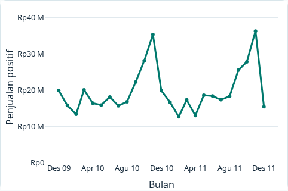
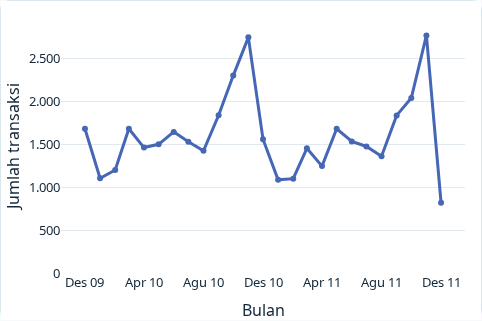
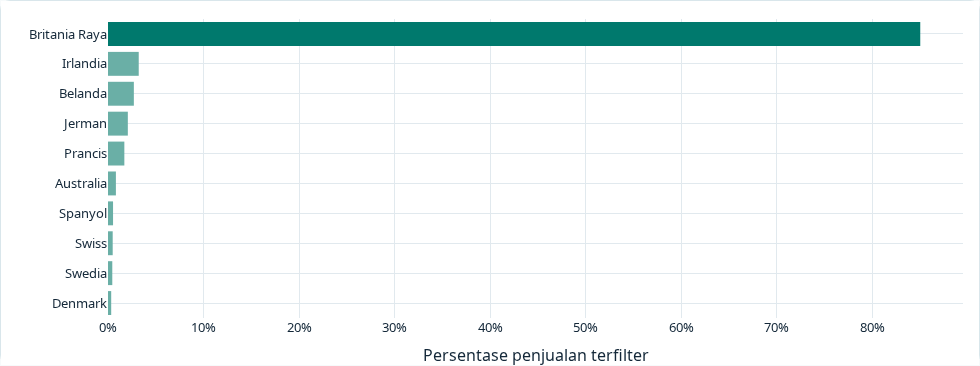
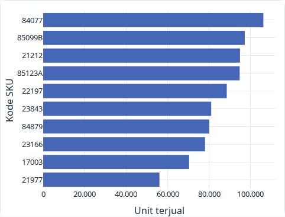
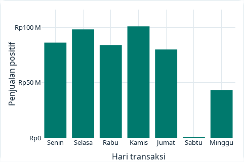
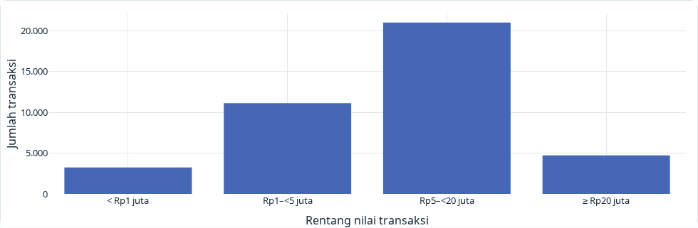
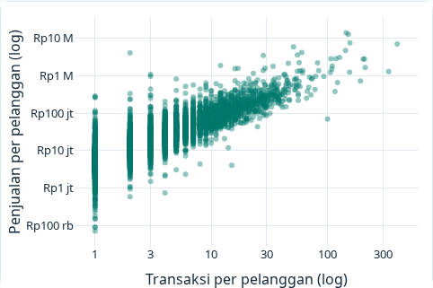
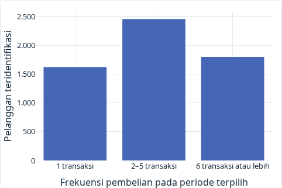

# Galeri Grafik

Tangkapan dashboard pada seluruh periode 1 Desember 2009 hingga 9 Desember 2011. Nilai Rupiah memakai konversi analitis.

## Penjualan positif per bulan

## Jumlah transaksi per bulan

## Kontribusi 10 negara dan wilayah terbesar

## Produk terlaris menurut unit

## Penjualan menurut hari

## Sebaran nilai transaksi

## Frekuensi dan nilai pembelian

## Pelanggan menurut jumlah transaksi

